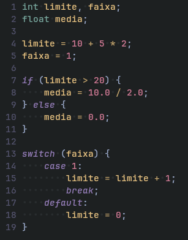
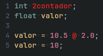

# bell.nvim

Plugin de Syntax Highlighting em tempo real para a linguagem **`bell`** no **Neovim**, alimentado pelo compilador **`bellc`** (`bellc --tokens`).

O plugin é **100% independente de pastas locais**: ele baixa o código-fonte do compilador diretamente do GitHub (`https://github.com/gabrielmusskopf/bell-lang.git`) para `~/.local/share/nvim/bell.nvim/src` e compila o binário **`bellc`** automaticamente!

## Estrutura do Projeto

```text
bell.nvim/
├── ftdetect/
│   └── bell.lua       # Reconhece automaticamente arquivos *.bell (filetype=bell)
├── lua/
│   └── bell/
│       └── init.lua   # Baixa/compila o bellc do GitHub e aplica Extmarks no Neovim
├── plugin/
│   └── bell.lua       # Autocmds em tempo real + comandos :BellHighlight e :BellUpdate
├── exemplo.bell       # Programa de exemplo na linguagem bell
├── install.sh         # Clona o compilador do GitHub, compila 'bellc' e instala o plugin
└── Makefile           # Atalhos 'make install' e 'make uninstall'
```

## Pré-requisitos no Sistema

Para que o plugin compile o `bellc` a partir do GitHub, sua máquina precisa ter:
- `git`, `make`, `gcc`, `flex` e `bison`.
- *(Importante: lembre-se de fazer `git push` das alterações mais recentes do repositório `bell-lang` para o GitHub!)*

---

## Instalação Automática

### Opção 1: Via `lazy.nvim` (100% Automático)

Adicione na sua configuração do **lazy.nvim** (ex.: em `~/.config/nvim/lua/config/plugins/bell.lua`):

```lua
return {
    "https://github.com/gabrielmusskopf/bell.nvim",
    build = "./install.sh"
}
```
> Mesmo que o `build` não tenha rodado, ao abrir o primeiro arquivo `.bell`, o `bell.nvim` detecta caso o binário `~/.local/share/nvim/bell.nvim/src/bellc` ainda não exista, faz o `git clone` do GitHub em background e compila o `bellc` sozinho!

---

### Opção 2: Via `make install` / `./install.sh`

Dentro da pasta `bell.nvim`, basta rodar:

```bash
make install
```

O script irá:
1. Clonar (ou atualizar) `https://github.com/gabrielmusskopf/bell-lang.git` em `~/.local/share/nvim/bell.nvim/src`;
2. Executar `make TARGET=bellc` para gerar o binário `~/.local/share/nvim/bell.nvim/src/bellc`;
3. Criar o link simbólico em `~/.config/nvim/plugin/bell.lua`.

Para desinstalar tudo (plugin + binário baixado):
```bash
make uninstall
```

---

## Comandos Disponíveis no Neovim

- `:BellUpdate` — Faz `git pull` do compilador no GitHub (`bell-lang`) e recompila o binário `bellc`.
- `:BellHighlight` — Força a aplicação de cores no buffer aberto atual.

---

## Screenshots




